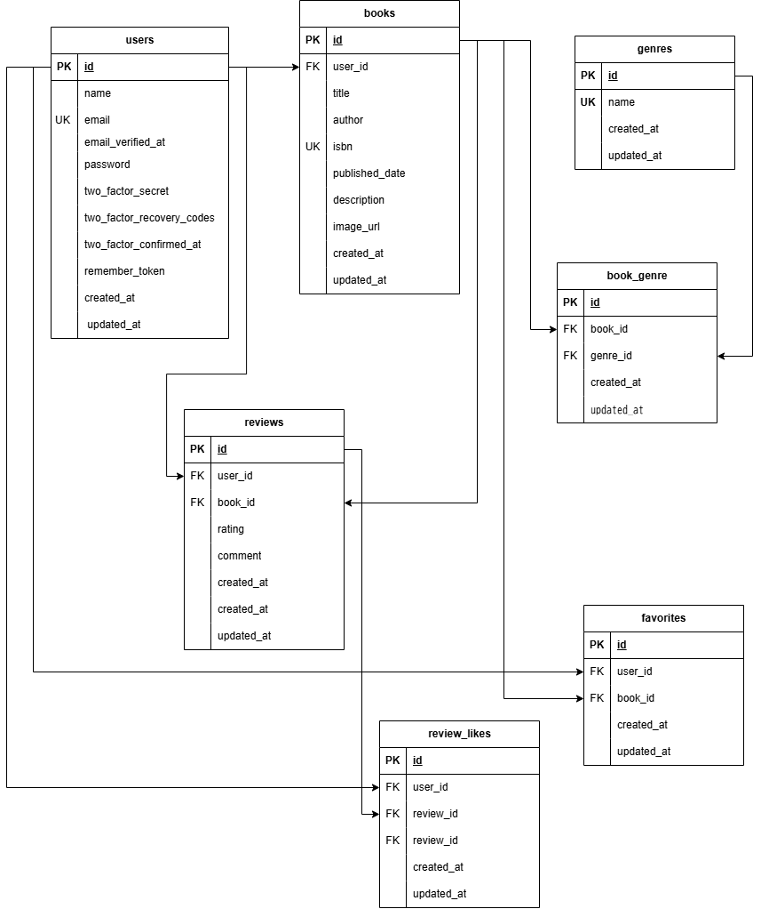

# BookShelf

## アプリケーション概要

BookShelfは、書籍の登録・管理やレビューの投稿ができるWebアプリケーションです。

ユーザーは書籍の検索、ジャンル別の閲覧、お気に入り登録、レビューの投稿・編集・削除などを行えます。

また、レビューの平均評価をもとにした書籍ランキングも閲覧できます。

## 使用技術

- PHP
- Laravel 10
- MySQL
- Laravel Sail（Docker）
- Laravel Fortify（認証機能）
- Tailwind CSS
- Alpine.js
- Vite

## 環境構築

### 1. リポジトリのクローン

```bash
git clone https://github.com/satomi-cell/bookshelf-app.git
cd bookshelf-app
```

### 2. PHPパッケージのインストール

```bash
composer install
```

### 3. 環境変数の設定

```bash
cp .env.example .env
```

`.env` のデータベース設定を確認してください。

```env
DB_CONNECTION=mysql
DB_HOST=mysql
DB_PORT=3306
DB_DATABASE=laravel
DB_USERNAME=sail
DB_PASSWORD=password
```

### 4. Laravel Sailの起動

```bash
./vendor/bin/sail up -d
```

### 5. アプリケーションキーの生成

```bash
./vendor/bin/sail artisan key:generate
```

### 6. データベースのマイグレーション

```bash
./vendor/bin/sail artisan migrate
```
  ### 初期データの登録（シーディング）

  以下のコマンドで、ユーザー・ジャンル・書籍・レビュー・お気に入り・レビューへのいいねの初期データを登録できます。

```bash
  ./vendor/bin/sail artisan db:seed
```
### 7. フロントエンドのパッケージをインストール

```bash
./vendor/bin/sail npm install
```

### 8. 開発サーバーの起動

```bash
./vendor/bin/sail npm run dev
```

### 9. アプリケーションへのアクセス

ブラウザで以下のURLにアクセスしてください。

http://localhost/books

## 機能一覧

### ユーザー認証
- ユーザー登録
- ログイン・ログアウト

### 書籍管理
- 書籍一覧表示
- 書籍詳細表示
- 書籍登録
- 書籍編集・削除

### ジャンル管理
- ジャンル一覧・詳細表示
- ジャンル登録・編集・削除
- ジャンル別の書籍表示

### レビュー機能
- レビュー投稿
- レビュー編集・削除
- 星評価（1〜5）
- レビューへのいいね

### お気に入り機能
- お気に入り登録・解除
- お気に入り一覧表示

### ランキング機能
- レビューの平均評価による書籍ランキング（上位10件）

### API機能
- 書籍一覧取得
- 書籍詳細取得
- 書籍登録・更新・削除
- 書籍検索・ジャンルによる絞り込み
- ページネーション

## ER図



## テスト

以下のコマンドでテストを実行できます。

```bash
./vendor/bin/sail artisan test
```